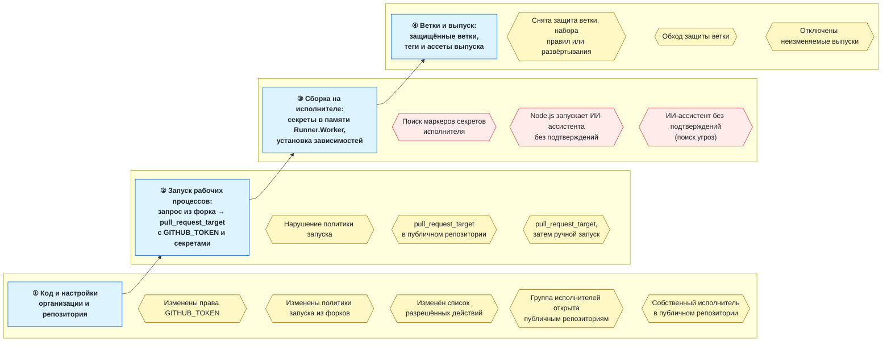
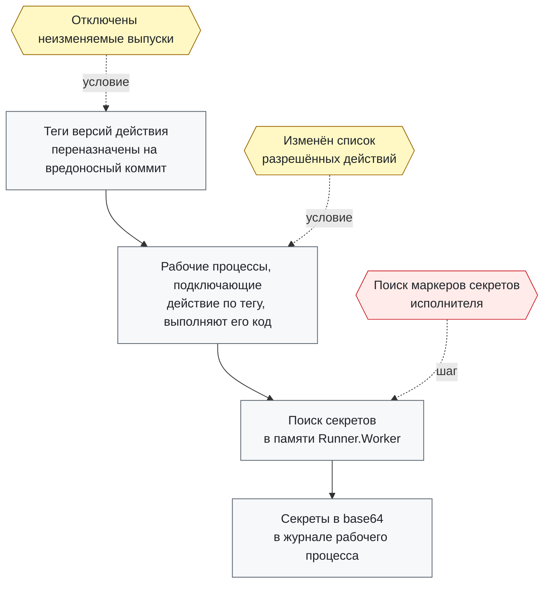
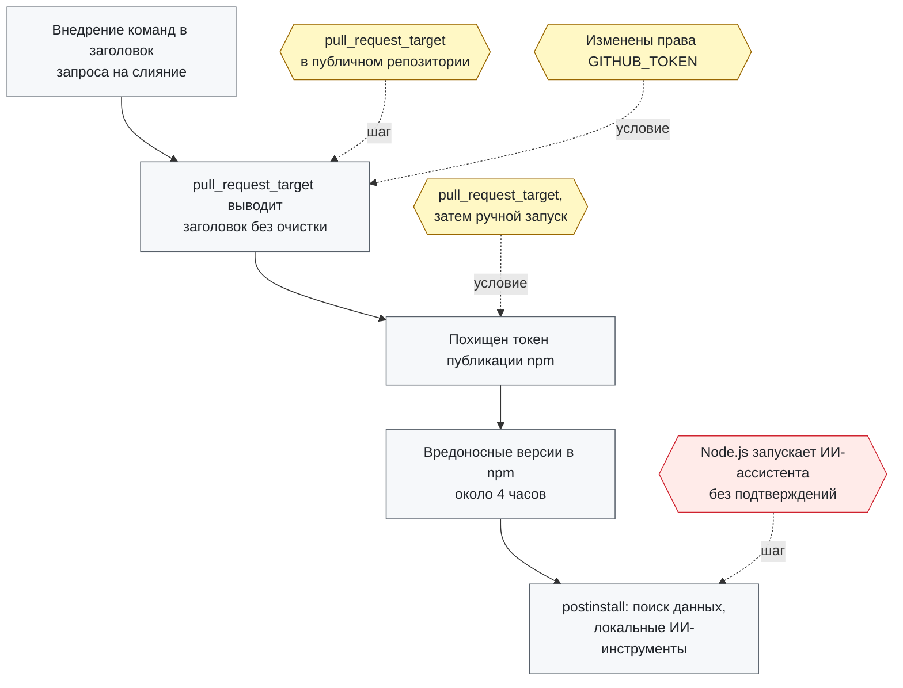
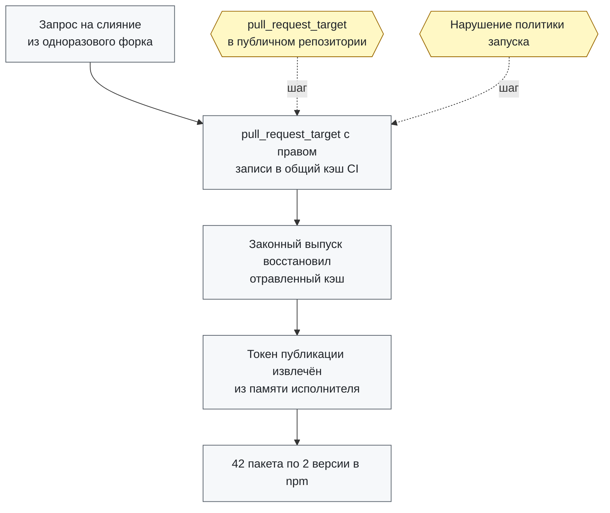
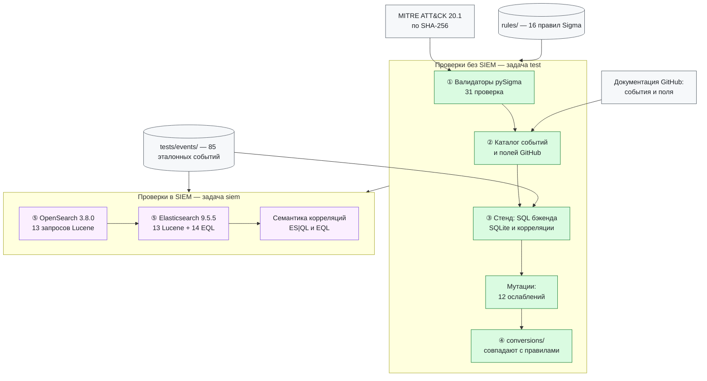
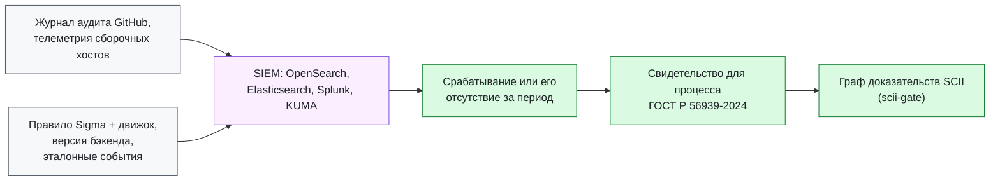

# cicd-sigma-rules

[](https://github.com/alexqzm/cicd-sigma-rules/actions/workflows/ci.yml)
[](LICENSE.Detection.Rules.md)
[](LICENSE)
[](https://attack.mitre.org)

Правила [Sigma](https://sigmahq.io) для обнаружения атак на конвейеры сборки и цепочку поставки
ПО: журнал аудита GitHub (GitHub Actions, исполнители, защита веток и выпусков) и создание
процессов на сборочных хостах Linux. Каждое правило привязано к инцидентам, рискам OWASP CI/CD и
процессам ГОСТ Р 56939-2024, проверено на эталонных событиях, а запросы для OpenSearch и
Elasticsearch на каждый коммит исполняются в самих движках.

Репозиторий — часть работы над диссертацией «Метод обеспечения целостности цепочки сборки и
обновления программного обеспечения киберфизических систем на основе графа доказательств»:
события сборочного конвейера, наблюдаемые в SIEM, как свидетельства для графа доказательств.

**Коротко:** 14 файлов правил (16 правил Sigma) · 85 эталонных событий · 31 валидатор pySigma ·
12 мутаций правил · 54 файла запросов для 4 целей · 80 исполнений запросов в OpenSearch 3.8.0 и
Elasticsearch 9.5.5 на коммит · 2 дефекта бэкенда EQL и расхождения семантики корреляций между
бэкендами.

**Содержание:** [где срабатывают правила](#где-в-конвейере-срабатывают-правила) ·
[правила](#правила) · [инциденты](#инциденты-и-правила) · [как проверены](#как-проверены-правила) ·
[находки](#находки) · [ГОСТ Р 56939-2024](#правила-и-процессы-гост-р-56939-2024) ·
[быстрый старт](#быстрый-старт) · [структура](#структура-репозитория) ·
[ограничения](#ограничения) · [English summary](#english-summary)

## Где в конвейере срабатывают правила

Правила смотрят на четыре участка конвейера. Жёлтые — события журнала аудита GitHub, красные —
создание процессов на сборочных хостах Linux (Sysmon for Linux, auditd или EDR).



## Правила

14 файлов правил: 10 правил журнала аудита GitHub, одна корреляция и 3 правила создания
процессов в Linux. Полная таблица с ATT&CK, инцидентами, OWASP, ГОСТ и числом эталонных событий —
[`docs/rules.md`](docs/rules.md).

| Правило | Уровень | Что ловит |
|---|---|---|
| Workflow Execution Protection Violation | средний | запуск рабочего процесса нарушил политику, ограничивающую акторов и триггеры (в том числе `pull_request_target`) |
| pull_request_target Run in Public Repository | низкий | запуск по `pull_request_target` в публичном репозитории |
| pull_request_target Run Followed by workflow_dispatch Run | низкий | корреляция: запуск по `pull_request_target`, а за ним в течение часа ручной запуск в том же репозитории (схема Nx, 2025) |
| Self-Hosted Runner Registered to Public Repository | средний | собственный исполнитель зарегистрирован в публичном репозитории |
| Runner Group Opened to Public Repositories | средний | группа исполнителей открыта публичным репозиториям |
| GITHUB_TOKEN Permission Policy Changed | низкий | изменены права `GITHUB_TOKEN` по умолчанию или право Actions одобрять запросы на слияние |
| Fork Pull Request Workflow Policy Changed | низкий | изменены политики запуска рабочих процессов из форков |
| Allowed Actions Policy Changed | низкий | изменён список разрешённых действий и переиспользуемых рабочих процессов |
| Immutable Releases Disabled or Policy Changed | средний | отключены неизменяемые выпуски (теги снова можно переносить) |
| Branch Protection, Ruleset or Deployment Protection Rule Removed | средний | снята защита ветки, удалён набор правил или правило защиты развёртывания |
| Branch Protection Requirement Overridden | средний | администратор обошёл требование защиты ветки |
| Search for GitHub Actions Runner Secret Markers | высокий | поиск маркера `isSecret` в дампе памяти исполнителя или загрузка `memdump.py` (tj-actions/changed-files, 2025) |
| Node.js Process Launching AI Coding CLI With Permission Bypass Flag | высокий | скрипт Node.js или Bun запускает `claude`, `gemini` или `q` с отключёнными подтверждениями (Nx s1ngularity, 2025) |
| AI Coding CLI Launched With Permission Bypass Flag | низкий | то же при любом родительском процессе — для поиска угроз |

Правила дополняют, а не повторяют [SigmaHQ](https://github.com/SigmaHQ/sigma): там есть общие
правила для журнала аудита GitHub (например, любое изменение собственных исполнителей) и
индикаторы конкретных кампаний; здесь — условия конвейера, которые эксплуатировались в
инцидентах. Где правило уточняет правило SigmaHQ, это указано в поле `related`.

## Инциденты и правила

Шаги атак — по записям атласа
[cps-supply-chain-atlas](https://github.com/alexqzm/cps-supply-chain-atlas) и разборам, на которые
они ссылаются. Пунктир ведёт от правила к шагу, который оно ловит («шаг»), или к шагу, который
стал возможен из-за отслеживаемой правилом настройки («условие»). Связи — оценка автора.

### tj-actions/changed-files, март 2025

Нарушитель задним числом переназначил теги версий действия на вредоносный коммит; код искал
секреты в памяти процесса Runner.Worker и выводил их в base64 в журнал рабочего процесса
([GHSA-mrrh-fwg8-r2c3](https://github.com/advisories/GHSA-mrrh-fwg8-r2c3),
[запись атласа](https://github.com/alexqzm/cps-supply-chain-atlas/blob/main/data/records/tj-actions-2025.yaml)).



### Nx (s1ngularity), август 2025

Рабочий процесс `pull_request_target` выводил заголовок запроса на слияние без очистки; у рабочих
процессов были права на запись, а процесс публикации допускал ручной запуск — токен публикации
npm был похищен. Скрипт `postinstall` вредоносных версий искал конфиденциальные данные и запускал
локальные ИИ-ассистенты с флагами, отключающими подтверждения
([разбор Nx](https://nx.dev/blog/s1ngularity-postmortem),
[Snyk](https://snyk.io/blog/weaponizing-ai-coding-agents-for-malware-in-the-nx-malicious-package/),
[запись атласа](https://github.com/alexqzm/cps-supply-chain-atlas/blob/main/data/records/nx-s1ngularity-2025.yaml)).



### TanStack, май 2026

Запрос на слияние из одноразового форка выполнился в рабочем процессе `pull_request_target` с
правом записи в общий кэш CI; законный выпуск восстановил отравленный кэш, токен публикации был
извлечён из памяти исполнителя, и 42 пакета по две версии ушли в npm
([разбор TanStack](https://tanstack.com/blog/incident-followup),
[запись атласа](https://github.com/alexqzm/cps-supply-chain-atlas/blob/main/data/records/tanstack-2026.yaml)).
Способ извлечения токена из памяти в разборе не раскрыт, поэтому правило поиска маркеров здесь не
привязано. Сейчас GitHub даёт запускам по `pull_request_target` кэш ветки по умолчанию только для
чтения, если рабочий процесс явно не объявил `cache-mode` с правом записи.



## Как проверены правила

Две задачи CI: проверки без SIEM (`test`, Python 3.11 и 3.13) и исполнение запросов в движках
(`siem`, OpenSearch и Elasticsearch как сервисные контейнеры, образы по дайджесту).



1. **Валидаторы pySigma** (31 валидатор) с закреплённой версией MITRE ATT&CK 20.1: файл
   `attack-stix-data` проверяется по SHA-256, теги — по этой версии
   ([`tools/check.py`](tools/check.py)).
2. **Только задокументированные события и поля GitHub.** Каталог
   [`data/github-audit-events.json`](data/github-audit-events.json) собран из документации
   GitHub; тест проверяет, что правила и эталонные события не используют событий и полей, которых
   нет в документации для этого события.
3. **Эталонные события.** 85 синтетических событий (39 должны сработать, 46 — нет), включая
   соседние события, обратный порядок, границы окна и регистр. Условия правил исполняются
   SQL-запросами, которые строит бэкенд pySigma для SQLite, — проверяется и правило, и его
   конвертация; корреляции — по спецификации Sigma ([`tools/harness.py`](tools/harness.py)).
   Мутационная проверка: 12 ослаблений правил (убрать условие, расширить значение, сменить
   окно, поле группировки или порядок корреляции) — каждое ловится хотя бы одним событием
   `nomatch` ([`tests/test_mutations.py`](tests/test_mutations.py)).
4. **Запросы для SIEM** ([`conversions/`](conversions/)) генерируются официальными бэкендами
   pySigma; CI падает, если они разошлись с правилами.
5. **Исполнение в движках.** Запросы Lucene и EQL исполняются в OpenSearch 3.8.0 и
   Elasticsearch 9.5.5 на тех же эталонных событиях при двух способах хранения строк — 80
   исполнений на коммит ([`docs/siem.md`](docs/siem.md)). Известные расхождения перечислены в
   [`tools/known_issues.py`](tools/known_issues.py); для дефектов бэкенда CI проверяет и
   исправленный запрос — так подтверждается, что дефект именно в этом месте.

Зависимости закреплены по версиям и хешам (`requirements.txt`, не новее 26.10.2026), действия
GitHub — по SHA коммита.

## Находки

- **Бэкенд EQL и логические поля.** Для `public_repo: true` pySigma-backend-elasticsearch 2.1.1
  пишет `public_repo:true`, а Elasticsearch 9.5.5 отклоняет `:` для логических полей (HTTP 400);
  с `==` запрос работает. Затронуты три правила.
- **Бэкенд EQL и корреляция `temporal_ordered`.** Запрос заканчивается на `by  with runs=2` с
  пустым полем и не разбирается; без этого хвоста — верен и находит ровно нужные сценарии.
- **Корреляции не переносятся между бэкендами** — см. ниже и
  [`docs/correlation.md`](docs/correlation.md).
- **Регистр.** Sigma сравнивает строки без учёта регистра, запрос Lucene в поле `keyword` без
  нормализатора — с учётом: событие `grep -aoi issecret` запрос Lucene находит только при
  нормализаторе `lowercase`, в обоих движках.
- **ATT&CK v20.** Тактики Defense Evasion в ATT&CK 20.1 нет (есть Stealth и Defense Impairment),
  T1562 Impair Defenses отозвана в пользу T1685; теги вроде `attack.defense-evasion` валидатор
  pySigma с ATT&CK 20.1 отклоняет.
- **Контекст GitHub.** Политики выполнения рабочих процессов ограничивают акторов и триггеры; для
  публичных репозиториев GitHub ввёл политику по умолчанию, блокирующую `pull_request_target`,
  с принудительным применением со 2 декабря 2026 г. После этой даты запуски по
  `pull_request_target` в публичных репозиториях означают явно разрешённое исключение.

### Корреляция: одно правило — разные запросы

Корреляция «`pull_request_target`, затем `workflow_dispatch` в том же репозитории за час» и её
вариант без требования порядка (`temporal`) на трёх парах событий. По спецификации Sigma
срабатывают пары near и cross, far — нет.

```mermaid
gantt
    title Пары pull_request_target → workflow_dispatch при окне 1 ч
    dateFormat HH:mm
    axisFormat %H:%M
    todayMarker off
    section 10 минут
    near — находят все :done, n1, 09:05, 10m
    section 40 минут
    cross — через границу часа, ES|QL не находит :active, c1, 10:40, 40m
    section 5 часов
    far — находит только EQL sample :crit, f1, 12:00, 300m
```



| Бэкенд | Как задано окно | Расхождение с Sigma | Проверено |
|---|---|---|---|
| SQLite | разброс времени всех событий группы | порядок не проверяется; пара не находится, если в группе есть более раннее событие | тестом |
| EQL, `temporal_ordered` | `sequence ... with maxspan=1h` + лишний хвост | запрос не разбирается; без хвоста — верен | в Elasticsearch |
| EQL, `temporal` | `sample by repo` | окна нет: находится far | в Elasticsearch |
| ES\|QL, `temporal` | корзины `date_trunc(1hours)` | cross не находится | в Elasticsearch |
| Splunk, `temporal` | корзины `bin _time span=1h` | как ES\|QL | по виду запроса |
| Lucene (OpenSearch, Elasticsearch) | — | корреляции не поддерживаются | — |

## Правила и процессы ГОСТ Р 56939-2024

Срабатывание правила или его отсутствие на журнале конвейера за период — наблюдаемое
свидетельство для процессов безопасной разработки. Чтобы свидетельство было проверяемым, к нему
прилагается не только текст правила, но и движок, версия бэкенда и эталонные события, на которых
правило проверено (оценка автора; см. находку о корреляциях).



Какие процессы затрагивает каждое правило — матрица ниже; она генерируется из
[`mappings/mappings.yml`](mappings/mappings.yml) и проверяется в CI. Там же риски OWASP CI/CD и
инциденты. Сопоставления — оценка автора.

<!-- mapping:begin -->
<!-- генерирует python -m tools.table; вручную не править -->

| Группа | Правило | 5.4 | 5.9 | 5.12 | 5.13 | 5.14 | 5.15 | 5.16 | 5.17 | 5.20 | 5.21 |
|---|---|---|---|---|---|---|---|---|---|---|---|
| Запуски рабочих процессов | Нарушение политики запуска рабочих процессов |  |  | ● | ● |  |  |  |  |  |  |
|  | Запуск по pull_request_target в публичном репозитории |  |  |  | ● |  | ● |  |  |  |  |
|  | pull_request_target, затем ручной запуск |  |  |  | ● |  | ● |  |  | ● |  |
| Политики и настройки GitHub Actions | Собственный исполнитель в публичном репозитории |  |  |  | ● |  |  |  |  |  |  |
|  | Группа исполнителей открыта публичным репозиториям |  |  |  | ● |  |  |  |  |  |  |
|  | Изменены права GITHUB_TOKEN |  |  |  |  | ● | ● |  |  |  |  |
|  | Изменены политики запуска из форков |  |  |  | ● | ● |  |  |  |  |  |
|  | Изменён список разрешённых действий |  |  | ● |  |  |  |  | ● |  |  |
| Защита веток и выпусков | Отключены неизменяемые выпуски |  |  |  |  |  |  |  |  | ● | ● |
|  | Снята защита ветки, набора правил или развёртывания | ● |  |  |  | ● |  |  |  |  |  |
|  | Обход защиты ветки |  | ● |  |  | ● |  |  |  |  |  |
| Сборочные хосты Linux | Поиск маркеров секретов исполнителя |  |  |  | ● |  | ● |  |  |  |  |
|  | Node.js запускает ИИ-ассистента без подтверждений |  |  |  |  |  |  | ● | ● |  |  |
|  | ИИ-ассистент без подтверждений (поиск угроз) |  |  |  | ● |  |  |  | ● |  |  |
| | **Правил** | **1** | **1** | **2** | **8** | **4** | **4** | **1** | **3** | **2** | **1** |

Процессы: 5.4 — управление конфигурацией; 5.9 — экспертиза исходного кода; 5.12 — безопасная система сборки; 5.13 — безопасность сборочной среды; 5.14 — доступ и целостность кода; 5.15 — безопасность секретов; 5.16 — композиционный анализ; 5.17 — вредоносный код в цепочке поставок; 5.20 — безопасный выпуск; 5.21 — безопасная поставка.

<!-- mapping:end -->

## Быстрый старт

```sh
python -m venv .venv && . .venv/bin/activate
python -m pip install --require-hashes -r requirements.txt
curl -sSfLo attack.json https://raw.githubusercontent.com/mitre-attack/attack-stix-data/a8db2f52eb933c9c99060c123e088b3326d3a607/enterprise-attack/enterprise-attack-20.1.json
python -m tools.check --attack attack.json   # валидаторы pySigma
python -m pytest -q                          # эталонные события, каталог, семантика, мутации
python -m tools.convert --check              # запросы совпадают с правилами
sigma convert -t splunk --without-pipeline rules/github/audit/   # свои запросы
```

Проверка в движках локально — в [`docs/siem.md`](docs/siem.md#как-повторить-локально).

## Структура репозитория

| Путь | Содержимое |
|---|---|
| `rules/` | правила Sigma: журнал аудита GitHub, корреляция, `process_creation` Linux |
| `tests/events/` | эталонные события: `match.jsonl` и `nomatch.jsonl` для каждого правила |
| `conversions/` | запросы OpenSearch, Elasticsearch (Lucene и EQL) и Splunk |
| `mappings/mappings.yml` | инциденты, риски OWASP CI/CD, процессы ГОСТ Р 56939-2024 |
| `data/github-audit-events.json` | каталог событий и полей журнала аудита GitHub |
| `pipelines/` | конвейер полей для KUMA (предложение, в KUMA не проверен) |
| `tools/` | проверка, стенд, конвертация, таблица и схема, проверка в движках |
| `docs/` | [правила](docs/rules.md), [источники и допущения](docs/logsources.md), [SIEM](docs/siem.md), [корреляции](docs/correlation.md), [KUMA](docs/kuma.md) |

## Связь с другими репозиториями

Инциденты — записи атласа [cps-supply-chain-atlas](https://github.com/alexqzm/cps-supply-chain-atlas)
(закреплённый коммит проверяется в CI). Процессы ГОСТ Р 56939-2024 — по модели
[rbpo-evidence](https://github.com/alexqzm/rbpo-evidence); гейт допуска —
[scii-gate](https://github.com/alexqzm/scii-gate).

## Ограничения

- Эталонные события синтетические: проверяется логика правил и конвертации, а не частота ложных
  срабатываний на реальных журналах. Все правила — `status: experimental`.
- Часть значений полей GitHub не задокументирована; допущения перечислены в
  [`docs/logsources.md`](docs/logsources.md).
- Запросы Splunk не исполнялись; в KUMA правила не проверялись.
- Сопоставления с инцидентами, OWASP и ГОСТ — оценка автора.

## Лицензии

Правила (`rules/`) — [Detection Rule License 1.1](LICENSE.Detection.Rules.md), как в SigmaHQ.
Код, документация и данные — [Apache-2.0](LICENSE). Имена событий и полей в
`data/github-audit-events.json` взяты из документации GitHub
([github/docs](https://github.com/github/docs), CC BY 4.0).

## Цитирование

См. [`CITATION.cff`](CITATION.cff).

## English summary

Sigma rules for attacks on CI/CD pipelines and the software supply chain: GitHub audit log
(Actions execution protections, `pull_request_target`, self-hosted runners, token and fork
policies, immutable releases, branch protection) and Linux process creation on build hosts
(runner memory secret scraping as in tj-actions/changed-files, AI coding CLIs launched with
permission bypass flags as in Nx s1ngularity). Each rule is mapped to incidents, OWASP Top 10
CI/CD risks and GOST R 56939-2024 processes and is tested on 85 synthetic reference events:
rule conditions run as SQL produced by the pySigma SQLite backend, correlations follow the
Sigma specification, and 12 rule mutations are caught. Queries generated by the official
pySigma backends are executed in OpenSearch 3.8.0 and Elasticsearch 9.5.5 in CI on every
commit. Findings: the EQL backend emits `field:true` for booleans (rejected by Elasticsearch)
and a malformed tail for `temporal_ordered` correlations; correlation semantics differ across
backends (no ordering in SQLite, fixed buckets in ES|QL and Splunk, no time window in EQL
`sample`); Lucene wildcard queries on non-normalized keyword fields are case-sensitive unlike
Sigma.
